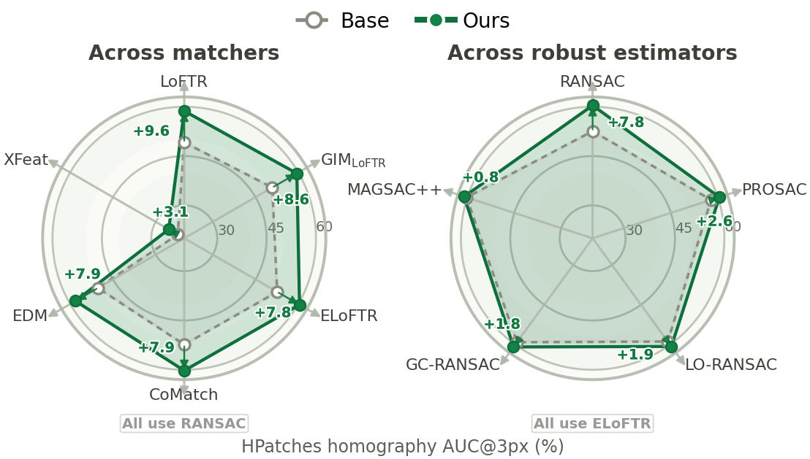
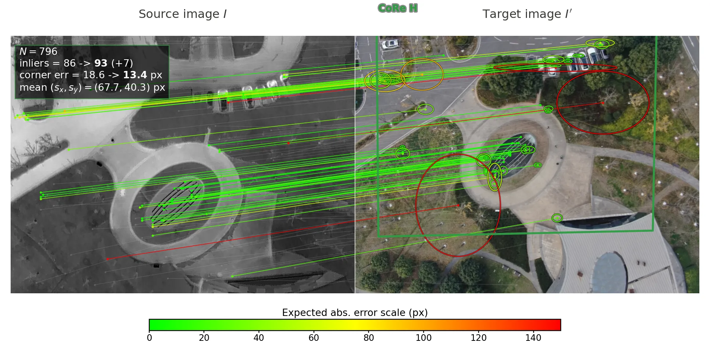
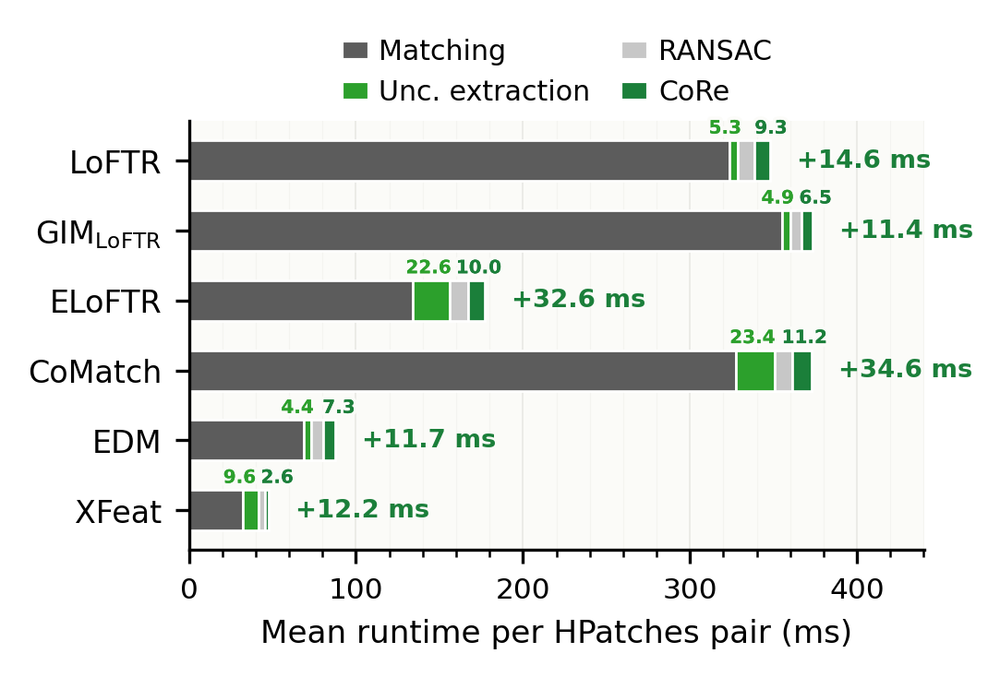
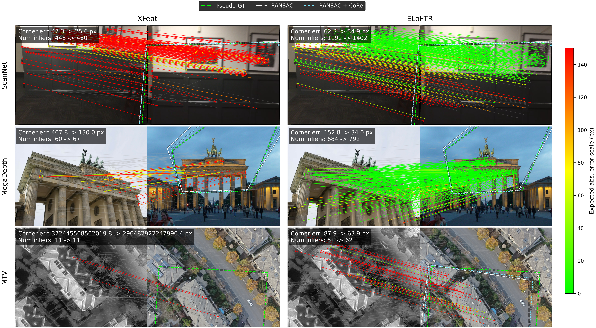

<p align="center">
  <h1 align="center">Semi-Dense Matching Uncertainty Is Not Just Local Confidence 🎯</h1>

  <h2 align="center">
    <!-- <p>!!</p> -->
    <a href="https://arxiv.org/abs/2608.08685" align="center">📄 Paper</a> | 
    <a href="https://huggingface.co/spaces/khoavpt/core-demo" align="center">🤗 Demo </a>  
  </h2>

</p>
<p align="center">
    
    <br>
    <em>CoRe is a lightweight, plug-and-play uncertainty estimation module that consistently improves downstream geometric estimation across diverse semi-dense matchers and robust estimators.</em>
</p>


This repository hosts the official implementation for **Semi-Dense Matching Uncertainty Is Not Just Local Confidence**. Our work is a lightweight, plug-and-play module for existing semi-dense matchers. It extracts uncertainty cues from the matching process to:

- Model the full spatial distribution of correspondence errors in pixel space.
- Improve robust geometry estimation through
  **Coarse-success Posterior Refit (CoRe)**.

### 🔌 Supported matchers

The code currently shows integration and experiments on various Semi-dense models including: [LoFTR](https://github.com/zju3dv/LoFTR), [GIM-LoFTR](https://github.com/xuelunshen/gim), [EfficientLoFTR](https://github.com/zju3dv/EfficientLoFTR), [CoMatch](https://github.com/ZizhuoLi/CoMatch), [EDM](https://github.com/chicleee/EDM), [XFeat](https://github.com/verlab/accelerated_features).

Installations, Usage and Experiment recreation details are mentioned below.

## Installation 

Clone the repo and setup environment using conda

```bash
git clone https://github.com/khoavpt/probabilistic-matching.git
cd probabilistic-matching

conda env create -f environment.yml
conda activate core
```

Download the checkpoint(s) you need into `weights/`:

| Matcher | Official checkpoint | Expected path |
|---|---|---|
| EfficientLoFTR | [download](https://drive.google.com/drive/folders/1GOw6iVqsB-f1vmG6rNmdCcgwfB4VZ7_Q?usp=sharing) | `weights/eloftr_outdoor.ckpt` |
| LoFTR | [download](https://drive.google.com/drive/folders/1DOcOPZb3-5cWxLqn256AhwUVjBPifhuf?usp=sharing) | `weights/loftr_outdoor.ckpt` |
| EDM | [download](https://drive.google.com/drive/folders/1PkYNihwgnNwqQeeewBz4OUDrvY8xFdH0?usp=sharing) | `weights/edm_outdoor.ckpt` |
| GIM-LoFTR | [GIM repository](https://github.com/xuelunshen/gim) | `weights/gim_loftr_50h.ckpt` |
| CoMatch | [download](https://drive.google.com/file/d/1DHd7LZtNH1vwhoTUA8a8nVIiIpx-38RX/view?usp=sharing) | `weights/comatch_outdoor.ckpt` |
| XFeat | [download](https://github.com/verlab/accelerated_features/raw/main/weights/xfeat.pt) | `weights/xfeat.pt` |

Pass `--weights /another/path/checkpoint` to any public script to override the
default location.

## Usage and Demo  [](https://huggingface.co/spaces/khoavpt/core-demo)

### Refinement with CoRe
Run the homography demo on one image pair:

```bash
python demo.py
```

Minimal script to use CoRe 

```python
from core import estimate_homography, load_calibration, refit_homography_core

params = load_calibration("calibration/params.json", "eloftr")
H0, inliers0 = estimate_homography(points0, points1, threshold=2.0)
H, inliers, weights = refit_homography_core(
    H0,
    points0,
    points1,
    std_coarse,
    std_fine,
    confidence,
    params,
    image_size=(1280, 960),
    threshold=2.0,
)
```

Equivalent versions for essential matrix estimation and PnP are provided in
`core/essential_ransac.py` and `core/pnp_ransac.py`.

<p align="center">
    
    <br>
    <em> 🤗 Hugging Face Spaces demo example</em>
</p>

### Calibration

The released calibration parameters are stored in
`calibration/params.json`.

We currently provide calibration code for MegaDepth-style datasets.
Calibration for other dataset formats can be implemented by adapting the
data loader accordingly.

```bash
MATCHERS=eloftr OUTPUT=calibration/eloftr_custom.json \
./scripts/fit_calibration.sh /path/to/MegaDepth/MegaDepth/train
```

To calibrate several supported matchers with the same wrapper:

```bash
MATCHERS="eloftr loftr xfeat" OUTPUT_DIR=outputs/calibration \
./scripts/fit_calibration.sh /path/to/MegaDepth/MegaDepth/train
```

## Reproduce Results

HPatches:

```bash
./scripts/run_hpatches.sh /path/to/hpatches-sequences-release
```

Robust estimators:

```bash
./scripts/run_robust_estimators.sh /path/to/hpatches-sequences-release
```

Aachen Day-Night v1.1:

```bash
./scripts/run_aachen.sh \
  /path/to/AachenDayNight/images/images_upright \
  /path/to/AachenDayNight/3D-models/aachen_v_1_1 \
  /path/to/AachenDayNight/queries/queries_with_intrinsics.txt \
  /path/to/pairs-query-netvlad50.txt
```

All wrappers accept extra CLI flags and support environment overrides. See
`scripts/README.md` for the common variables.

<p align="center">
  
  <br>
  <em> Our method introduces minimal overhead, acting as a lightweight post-processing step.</em>
</p>

## More Qualitative Results

<p align="center">
  
</p>

## Citation

If you find this work useful, please cite the paper.

```bibtex
@misc{hoang2026semidensematchinguncertaintyjust,
      title={Semi-Dense Matching Uncertainty Is Not Just Local Confidence}, 
      author={Khoa Hoang and Hoang-Tuan Nguyen and Huong Ninh and Hai Tran and Long Q. Tran},
      year={2026},
      eprint={2608.08685},
      archivePrefix={arXiv},
      primaryClass={cs.CV},
      url={https://arxiv.org/abs/2608.08685}, 
}
```

## Acknowledgements and license

This work builds on the official matcher and robust-estimator
implementations. Third-party code remains under the licenses included in each
subdirectory.

<!-- TODO(release): add the chosen license -->
